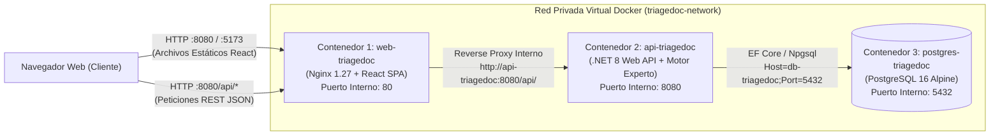

# Documentación Técnica de Implementación: Arquitectura Full-Stack y Contenerización (TriageDoc)

**Asignatura:** IS-912 Sistemas Expertos (Programación Web)  
**Proyecto:** TriageDoc — Sistema Experto de Clasificación Médica (Manchester Triage System)  
**Alcance del Documento:** Guía detallada paso a paso de la implementación del Frontend (React), integración con Backend (.NET 8 Clean Architecture), construcción Multi-Stage con Docker, servidor Nginx y orquestación con Docker Compose.

---

## 1. Visión General de la Arquitectura Implementada

El sistema **TriageDoc** fue diseñado bajo una arquitectura **API-First** y **Clean Architecture** dentro de un **Monorepo**, aislando completamente las tres capas de ejecución mediante contenedores de Docker conectados a través de una red virtual privada (`triagedoc-network`).



---

## 2. Paso 1: Sincronización entre Base de Datos (PostgreSQL) y ORM (Entity Framework Core)

Para garantizar que el contenedor de PostgreSQL y el contenedor de .NET trabajen sin conflictos de esquema desde el primer arranque, se implementaron tres mecanismos clave:

### 2.1. Mapeo explícito `snake_case` en `TriageDocDbContext.cs`
El script de inicialización SQL (`infra/init.sql`) define las 4 tablas normalizadas en Tercera Forma Normal (3FN) utilizando nomenclatura estándar de PostgreSQL en minúsculas y guiones bajos (`pacientes`, `sintomas`, `protocolos_atencion`, `evaluaciones_triage`).

En `backend/TriageDoc.Infrastructure/Data/TriageDocDbContext.cs`, se configuró Fluent API con `.HasColumnName(...)` en cada propiedad de las entidades para que las consultas SQL generadas por Entity Framework Core coincidan exactamente con las columnas físicas de `init.sql`:

```csharp
modelBuilder.Entity<Paciente>(entity =>
{
    entity.ToTable("pacientes");
    entity.HasKey(p => p.Id);
    entity.Property(p => p.Id).HasColumnName("id");
    entity.Property(p => p.Dni).HasColumnName("dni").IsRequired().HasMaxLength(20);
    entity.Property(p => p.NombreCompleto).HasColumnName("nombre_completo").IsRequired().HasMaxLength(150);
    entity.Property(p => p.Edad).HasColumnName("edad");
    entity.Property(p => p.Genero).HasColumnName("genero").HasMaxLength(20);
    entity.Property(p => p.Telefono).HasColumnName("telefono").HasMaxLength(25);
    entity.Property(p => p.FechaRegistro).HasColumnName("fecha_registro");
});
```

### 2.2. Sincronización de Secuencias Autoincrementables (`SERIAL`) en `init.sql`
Cuando se insertan datos semilla (*Seed Data*) indicando un `id` explícito en PostgreSQL (`INSERT INTO pacientes (id, ...) VALUES (1, ...)`), el contador interno de la secuencia `SERIAL` no avanza automáticamente. Si no se actualiza la secuencia, el primer registro nuevo enviado desde el Frontend provocaría un error de llave primaria duplicada (`ID = 1`).

Para resolverlo, al final de `infra/init.sql` se agregó la calibración automática de las secuencias de las 4 tablas:

```sql
SELECT setval(pg_get_serial_sequence('protocolos_atencion', 'id'), COALESCE((SELECT MAX(id) FROM protocolos_atencion), 1));
SELECT setval(pg_get_serial_sequence('sintomas', 'id'), COALESCE((SELECT MAX(id) FROM sintomas), 1));
SELECT setval(pg_get_serial_sequence('pacientes', 'id'), COALESCE((SELECT MAX(id) FROM pacientes), 1));
SELECT setval(pg_get_serial_sequence('evaluaciones_triage', 'id'), COALESCE((SELECT MAX(id) FROM evaluaciones_triage), 1));
```

### 2.3. Compatibilidad de Marcas de Tiempo y Verificación en `Program.cs`
En `backend/TriageDoc.API/Program.cs` se habilitó el interruptor `Npgsql.EnableLegacyTimestampBehavior` para permitir almacenar fechas `DateTime.UtcNow` en columnas `TIMESTAMP WITHOUT TIME ZONE`, y se incluyó un bloque de verificación `db.Database.EnsureCreated()` al iniciar la aplicación.

---

## 3. Paso 2: Implementación del Cliente Web (React + Vite) y Colorimetría Clínica

El frontend fue desarrollado en `TriageDoc/frontend` como una **Single Page Application (SPA)** modular en React 18.

### 3.1. Diseño Visual y Colorimetría Clínica
Se adoptó una estética hospitalaria sobria inspirada en sistemas de gestión clínica (estilo *BookMedik*), priorizando la legibilidad y reduciendo la fatiga visual:
* **Navegación Estructural (`#222222` y `#080808`):** Barra superior fija y barra lateral izquierda oscura para separar claramente la navegación de los datos clínicos.
* **Área de Trabajo Blanca (`#ffffff`):** Tablas con bordes definidos (`#dddddd`), formularios limpios y barras de filtrado con bloques de icono (`input-group-addon` en `#eeeeee`).
* **Semántica de Botones Clínicos:**
  * **Azul (`#428bca`):** Búsqueda, ejecución del motor de inferencia y guardado de registros.
  * **Ámbar (`#f0ad4e`):** Edición de registros y apertura de dictámenes clínicos.
  * **Rojo Coral (`#d9534f`):** Eliminación de registros.
* **Iconografía Vectorial (`src/components/Icons.jsx`):** Se prescindió por completo del uso de emoticones, implementando iconos SVG monocromáticos limpios.

### 3.2. Módulos Funcionales Conectados a la API
1. **`MedicalDashboard.jsx` (Evaluaciones de Triage):**
   * Muestra el resumen estadístico de los 5 niveles del **Manchester Triage System** (*Rojo, Naranja, Amarillo, Verde y Azul*).
   * Incluye barra de búsqueda multicriterio (palabra clave, selector de paciente, nivel de prioridad MTS y fecha).
   * Presenta la tabla de evaluaciones y permite inspeccionar el dictamen detallado y la regla disparada por el sistema experto.
2. **`TriageEvaluationForm.jsx` (Motor de Inferencia Clínica):**
   * Permite seleccionar un paciente existente o registrar uno nuevo sin salir de la pantalla.
   * Captura signos vitales (`Temperatura`, `Frecuencia Cardíaca`, `Presión Arterial`, `Saturación SpO2`), banderas rojas (`Dolor Torácico`, `Dificultad Respiratoria`) y síntomas del catálogo maestro.
   * Envía la petición `POST /api/evaluaciones` al backend, donde `TriageService.cs` evalúa las reglas de producción (`REGLA-01` a `REGLA-05`) y devuelve el nivel de prioridad, el tiempo máximo de espera, el área de derivación y la justificación clínica.
3. **`PacientesManager.jsx` (Gestión CRUD de Pacientes):**
   * Implementa el ciclo completo `GET`, `POST`, `PUT` y `DELETE` contra `/api/pacientes`, además de la consulta del historial clínico individual mediante `GET /api/evaluaciones/paciente/{id}`.
4. **`KnowledgeBaseManager.jsx` (Base de Conocimiento: Síntomas y Protocolos):**
   * Administra el catálogo de síntomas (`/api/sintomas`), permite filtrar exclusivamente signos de alarma (`/api/sintomas/alarmas`) y editar los tiempos de espera y áreas de derivación de los 5 protocolos Manchester (`/api/protocolos`).

---

## 4. Paso 3: Contenerización del Backend (.NET) con Multi-Stage Build

Archivo: `TriageDoc/backend/Dockerfile`

Para evitar que la imagen de producción del backend contenga herramientas pesadas de compilación (el SDK de .NET pesa más de 700 MB), se utilizó la técnica de **Multi-Stage Build** en dos etapas:

### Etapa 1: Compilación (`build`)
Utiliza la imagen `mcr.microsoft.com/dotnet/sdk:8.0-alpine`:
1. Copia primero el archivo `.sln` y los cuatro archivos `.csproj` (`Domain`, `Application`, `Infrastructure`, `API`).
2. Ejecuta `dotnet restore`. Docker guarda esta capa en caché; si el desarrollador modifica solo archivos `.cs` sin agregar paquetes NuGet nuevos, Docker no vuelve a descargar los paquetes.
3. Copia el resto del código fuente y ejecuta `dotnet publish -c Release -o /app/publish /p:UseAppHost=false`, generando los binarios optimizados.

### Etapa 2: Ejecución Ligera (`runtime`)
Utiliza la imagen ultraligera `mcr.microsoft.com/dotnet/aspnet:8.0-alpine` (~100 MB):
1. No contiene compiladores ni el código fuente `.cs`.
2. Extrae únicamente la carpeta `/app/publish` generada en la Etapa 1 mediante `COPY --from=build /app/publish .`.
3. Configura `ASPNETCORE_URLS=http://+:8080` e inicia el proceso con `ENTRYPOINT ["dotnet", "TriageDoc.API.dll"]`.

---

## 5. Paso 4: Contenerización del Frontend (React + Nginx) con Multi-Stage Build

Archivos: `TriageDoc/frontend/Dockerfile` y `TriageDoc/frontend/nginx.conf`

Una aplicación React en producción no debe ejecutarse con el servidor de desarrollo de Vite (`npm run dev`), sino compilarse a archivos estáticos (`HTML`, `CSS` y `JS` minificados) y servirse desde un servidor web de alto rendimiento como **Nginx**.

### 5.1. El `Dockerfile` del Frontend en 2 Etapas
* **Etapa 1 (`build` — `node:22-alpine`):**
  1. Copia `package.json` y ejecuta `npm install` para descargar las librerías de React y Vite.
  2. Copia el código fuente de `src/` y ejecuta `npm run build` con la variable `VITE_API_URL=/api`.
  3. Vite empaqueta y optimiza toda la aplicación dentro del directorio `/app/dist`.
* **Etapa 2 (`production` — `nginx:1.27-alpine`):**
  1. Descarta por completo Node.js y la carpeta `node_modules`.
  2. Copia el archivo de configuración `nginx.conf` hacia `/etc/nginx/conf.d/default.conf`.
  3. Extrae únicamente los archivos estáticos compilados con `COPY --from=build /app/dist /usr/share/nginx/html`.

### 5.2. Cómo funciona la Configuración de Nginx (`nginx.conf`)
El archivo `TriageDoc/frontend/nginx.conf` cumple dos funciones esenciales en la arquitectura:

```nginx
server {
    listen 80;
    server_name localhost;

    root /usr/share/nginx/html;
    index index.html index.htm;

    # 1. Reverse Proxy hacia el contenedor del Backend (.NET)
    location /api/ {
        proxy_pass http://api-triagedoc:8080/api/;
        proxy_http_version 1.1;
        proxy_set_header Host $host;
        proxy_set_header X-Real-IP $remote_addr;
        proxy_set_header X-Forwarded-For $proxy_add_x_forwarded_for;
        proxy_set_header X-Forwarded-Proto $scheme;
    }

    # 2. Soporte para Enrutamiento SPA (Single Page Application)
    location / {
        try_files $uri $uri/ /index.html;
    }
}
```

1. **Soporte SPA (`try_files $uri $uri/ /index.html;`):** Cuando un usuario navega o recarga la página en una ruta manejada por React, Nginx busca primero si existe un archivo físico con ese nombre (`$uri`); si no existe, en lugar de devolver un error `404 Not Found`, entrega `/index.html` para que React tome el control de la interfaz.
2. **Reverse Proxy Interno (`location /api/`):** Todas las peticiones HTTP que el navegador hace hacia `/api/...` son interceptadas por Nginx y redirigidas internamente a `http://api-triagedoc:8080/api/` usando el DNS interno de Docker. Esto evita problemas de CORS y mantiene oculta la topología interna frente al navegador.

---

## 6. Paso 5: Orquestación de los 3 Servicios con Docker Compose

Archivos: `TriageDoc/docker-compose.yml` y `TriageDoc/infra/docker-compose.yml`

El archivo `docker-compose.yml` coordina el ciclo de vida, las variables de entorno, el orden de encendido y la red privada de los 3 contenedores:

1. **Servicio 1 (`db-triagedoc` — PostgreSQL 16):**
   * Monta el volumen persistente `postgres_data` y ejecuta automáticamente `init.sql` al inicializar la base de datos.
   * Define un **`healthcheck`** (`pg_isready -U admin -d TriageDocDB`) que verifica cada 5 segundos si el motor SQL ya acepta conexiones.
2. **Servicio 2 (`api-triagedoc` — Backend .NET 8):**
   * Compila su imagen usando `./backend/Dockerfile`.
   * Utiliza `depends_on` con la condición `service_healthy` sobre `db-triagedoc`. Así, el contenedor de .NET espera hasta que PostgreSQL esté completamente listo antes de iniciar.
   * Recibe por variable de entorno la cadena de conexión apuntando al nombre de servicio DNS interno `Host=db-triagedoc;Port=5432;...`.
   * Expone el puerto `5000:8080` hacia la máquina anfitriona para poder inspeccionar Swagger UI directamente.
3. **Servicio 3 (`web-triagedoc` — Frontend React + Nginx):**
   * Compila su imagen usando `./frontend/Dockerfile`.
   * Depende de `api-triagedoc` y publica el puerto `80` de Nginx hacia los puertos `8080` y `5173` del host.

---

## 7. Guía de Demostración Paso a Paso (Auditoría en Vivo)

### 7.1. Levantar toda la arquitectura con un solo comando
Abrir una terminal en la carpeta `TriageDoc` y ejecutar:

```bash
docker compose up --build
```

### 7.2. Verificar los 3 servicios en ejecución
En otra terminal, comprobar que los 3 contenedores están activos y en la misma red:

```bash
docker ps
```

Se observarán los 3 contenedores corriendo:
* `postgres-triagedoc` (Puerto `5432->5432/tcp`, estado `healthy`)
* `api-triagedoc` (Puerto `5000->8080/tcp`)
* `web-triagedoc` (Puertos `5173->80/tcp`, `8080->80/tcp`)

### 7.3. Probar la interacción de extremo a extremo
1. **Cliente Web (React + Nginx):** Abrir `http://localhost:8080` (o `http://localhost:5173`).
   * En la barra superior derecha, verificar el indicador en verde: **`API Conectada (.NET + PostgreSQL)`**.
2. **Ejecutar el Motor Experto:**
   * Ir al menú lateral **Motor de Inferencia**.
   * Seleccionar una plantilla de caso clínico o ingresar signos vitales y hacer clic en **Ejecutar Inferencia y Clasificar Paciente**.
   * Observar cómo la petición viaja desde el navegador hacia **Nginx** (`/api/evaluaciones`), Nginx la redirige al contenedor **.NET** (`api-triagedoc`), el motor experto infiere la prioridad Manchester y **PostgreSQL** (`db-triagedoc`) persiste la evaluación.
3. **Documentación OpenAPI (Swagger):** Abrir `http://localhost:5000/swagger` para visualizar y probar directamente los contratos REST del contenedor backend.
