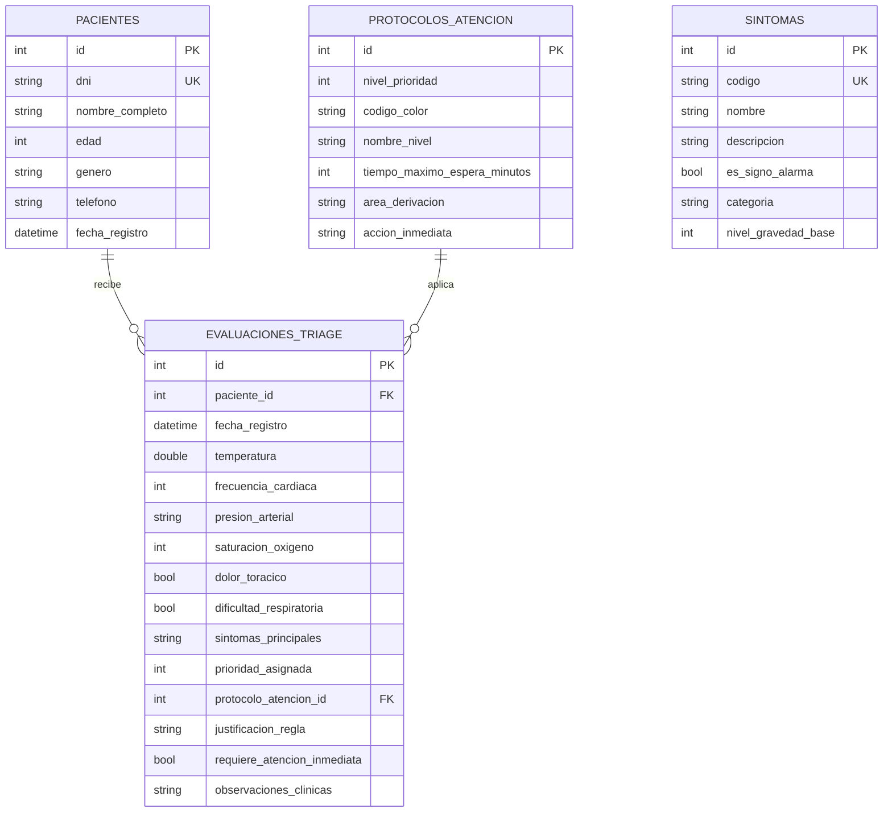

# TriageDoc - Sistema Experto de Triage y Orientación Médica

> **Asignatura:** IS-912 Sistemas Expertos (Programación Web)  
> **Alcance:** UNIDAD 1 - Arquitectura Limpia, Datos y API Core (Clases 1 a 9)  
> **Arquitectura:** Monorepo con Clean Architecture (API-First), Docker y Principios SOLID  
> **Stack Tecnológico:** C# y .NET 8, PostgreSQL 16, Entity Framework Core, FluentValidation

---

## 1. Descripción del Proyecto

**TriageDoc** es un sistema experto de clasificación de urgencias médicas basado en el estándar internacional de **Manchester Triage System (MTS)**. El motor de inferencia analiza los signos vitales del paciente, síntomas críticos y banderas rojas (dolor torácico, dificultad respiratoria, saturación de oxígeno, temperatura y frecuencia cardíaca) para determinar de forma automática:
1. El **Nivel de Prioridad** (Código Rojo, Naranja, Amarillo, Verde o Azul).
2. El **Tiempo Máximo de Espera**.
3. El **Área de Derivación Hospitalaria** (Shock Trauma, Urgencias, Observación, etc.).
4. La **Justificación Clínica de la Regla** inferida por el sistema experto.

---

## 2. Modelo Relacional de 4 Tablas (3FN)

El sistema implementa un modelo normalizado en Tercera Forma Normal (3FN) compuesto por 4 tablas interconectadas:

1. **`pacientes`**: Almacena los datos de filiación del paciente (DNI único, Nombre Completo, Edad, Género, Teléfono).
2. **`sintomas`**: Catálogo maestro de síntomas clínicos, especificando si son signos de alarma ("Banderas Rojas"), su categoría y nivel de gravedad base.
3. **`protocolos_atencion`**: Catálogo estandarizado del sistema Manchester con tiempos máximos de espera, códigos de color y áreas clínicas de derivación.
4. **`evaluaciones_triage`**: Tabla transaccional central que vincula al paciente con sus signos vitales medidos, la prioridad calculada por el motor experto, la justificación de la regla clínica y el protocolo de atención asignado.



---

## 3. Mapeo de Conceptos de la Unidad 1

El proyecto aplica directamente cada una de las clases de la Unidad 1:

| Clase | Concepto Evaluado | Implementación en TriageDoc |
|---|---|---|
| **Clase 1** | Arquitectura API-First y Cliente-Servidor | Separación desacoplada entre Backend y Frontend en monorepo. |
| **Clase 2** | Principios SOLID y Código Limpio | SRP en servicios, OCP en reglas y DIP con inyección de interfaces. |
| **Clase 3** | Setup Monorepo y Clean Architecture | Organización estricta en capas: `Domain`, `Application`, `Infrastructure`, `API`. |
| **Clase 4** | Docker, ORM y Variables de Entorno (12-Factor) | PostgreSQL 16 aislado en `infra/` con `.env`, lectura vía `DotNetEnv`. |
| **Clase 5** | Patrón Repositorio e Inversión de Dependencias (DIP) | `IPacienteRepository`, `ISintomaRepository`, etc., inyectados vía `AddInfrastructure()`. |
| **Clase 6** | Migraciones Code-First y Controladores REST | Mapeo relacional en `TriageDocDbContext` y endpoints REST con verbos semánticos. |
| **Clase 7** | Documentación OpenAPI y Pruebas con REST Client | Swagger UI y suite de pruebas ejecutables en `TriageDoc.API.http`. |
| **Clase 8** | DTOs, FluentValidation y Vertical Slicing | Organización por `Features/`, escudos DTOs contra over-posting y validadores de entrada. |
| **Clase 9** | Sprint Review y Ciclo CRUD Completo | Implementación completa de GET, GET/{id}, POST, PUT y DELETE con códigos 200, 201, 204 y 404. |

---

## 4. Estructura de la Solución (Clean Architecture + Docker + Nginx)

```text
TriageDoc/
├── docker-compose.yml                    # Orquestación de los 3 Servicios (DB + API + React/Nginx)
├── infra/                                # Infraestructura Aislada (Clase 4)
│   ├── docker-compose.yml                # Orquestación equivalente desde /infra
│   ├── init.sql                          # Inicialización de las 4 tablas, secuencias y Seed Data
│   ├── .env                              # Credenciales aisladas del contenedor PostgreSQL
│   └── .env.example
├── backend/
│   ├── Dockerfile                        # Multi-stage build (.NET 8 SDK -> ASP.NET Runtime)
│   ├── TriageDoc.Domain/                 # Capa de Dominio (Entidades Puras)
│   │   └── Entities/
│   │       ├── Paciente.cs
│   │       ├── Sintoma.cs
│   │       ├── ProtocoloAtencion.cs
│   │       ├── EvaluacionTriage.cs
│   │       └── NivelPrioridad.cs
│   ├── TriageDoc.Application/            # Capa de Aplicación (Reglas de Negocio)
│   │   ├── Interfaces/                   # Contratos de Repositorio (DIP)
│   │   ├── Services/                     # Motor Experto (TriageService)
│   │   ├── Features/                     # Vertical Slicing por Funcionalidad (Clase 8)
│   │   │   ├── Pacientes/ (DTOs y Validators)
│   │   │   ├── Sintomas/ (DTOs y Validators)
│   │   │   ├── Protocolos/ (DTOs y Validators)
│   │   │   └── Evaluaciones/ (DTOs y Validators)
│   │   └── DependencyInjection.cs
│   ├── TriageDoc.Infrastructure/         # Capa de Infraestructura (EF Core y Postgres)
│   │   ├── Data/TriageDocDbContext.cs    # Mapeo relacional snake_case y HasData
│   │   ├── Repositories/                 # Implementaciones de Repositorio
│   │   └── DependencyInjection.cs
│   └── TriageDoc.API/                    # Capa de Presentación (Controladores REST)
│       ├── Controllers/                  # Pacientes, Sintomas, Protocolos, Evaluaciones, Triage
│       ├── Program.cs                    # Configuración de Pipeline, EnsureCreated y Swagger
│       ├── TriageDoc.API.http            # Suite de pruebas ágiles (Clase 7 y 9)
│       ├── .env                          # Cadena de conexión inyectada
│       └── appsettings.json
├── frontend/                             # Cliente Web SPA (React 18 + Vite + Nginx)
│   ├── Dockerfile                        # Multi-stage build (Node 22 Build -> Nginx Alpine)
│   ├── nginx.conf                        # Reverse Proxy (/api) + Enrutamiento SPA (try_files)
│   ├── package.json
│   ├── vite.config.js
│   └── src/
│       ├── App.jsx                       # Layout Clínico (Barra Superior + Sidebar + Módulos)
│       ├── styles.css                    # Colorimetría Clínica (Estilo BookMedik + MTS)
│       ├── services/api.js               # Cliente HTTP hacia /api con respaldo local
│       └── components/
│           ├── MedicalDashboard.jsx      # Tabla y filtros de Evaluaciones Manchester
│           ├── TriageEvaluationForm.jsx  # Formulario e Inferencia del Motor Experto
│           ├── PacientesManager.jsx      # Directorio y CRUD de Pacientes + Historial
│           ├── KnowledgeBaseManager.jsx  # Catálogo de Síntomas, Alarmas y Protocolos
│           └── Icons.jsx                 # Iconografía SVG vectorial (sin emojis)
└── README.md
```

---

## 5. Puesta en Marcha y Contenerización Completa (Docker + Nginx)

### Opción A: Levantar los 3 Servicios con un solo comando (Recomendado - Tema 4)
Desde la carpeta `TriageDoc/` (o desde `TriageDoc/infra/`):
```bash
docker compose up --build
```
Esto levanta en la red privada virtual `triagedoc-network`:
1. **`postgres-triagedoc`** (PostgreSQL 16 en puerto `5432`, inicializado con `init.sql`).
2. **`api-triagedoc`** (Backend .NET 8 en puerto `5000` -> `http://localhost:5000/swagger`).
3. **`web-triagedoc`** (Frontend React servido por Nginx en `http://localhost:8080` y `http://localhost:5173`, redirigiendo `/api/` internamente a `api-triagedoc:8080/api/`).

### Opción B: Ejecución en Desarrollo Local
1. **Base de Datos:**
   ```bash
   cd infra
   docker compose up -d db-triagedoc
   ```
2. **Backend (.NET 8):**
   ```bash
   cd ../backend/TriageDoc.API
   dotnet run
   ```
3. **Frontend (React + Vite):**
   ```bash
   cd ../../frontend
   npm install
   npm run dev
   ```
